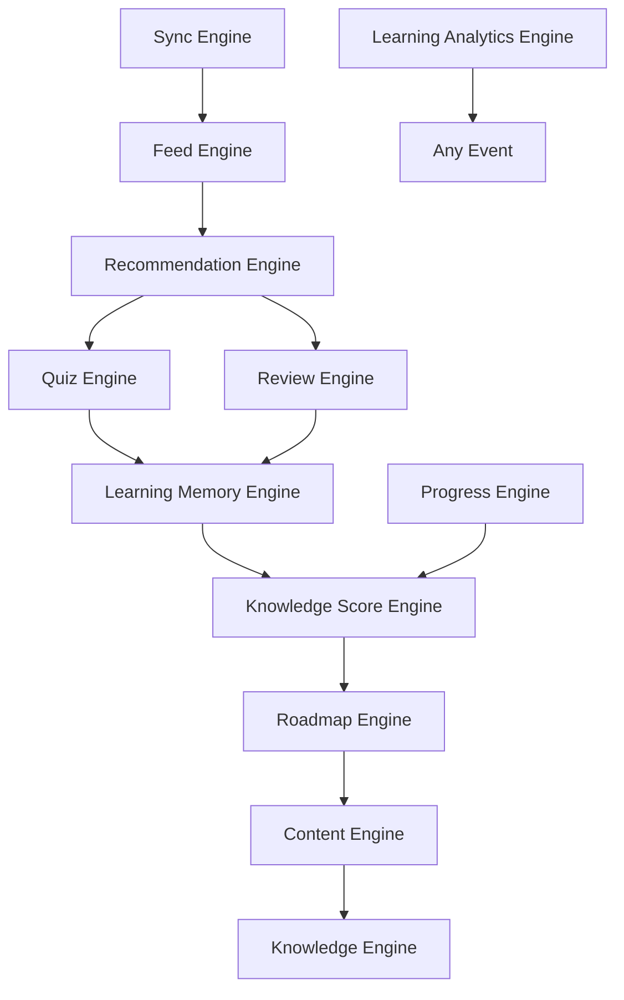

# LearnWitMe Domain Engine Specification
## Architecture Bible v1.2

Dokumen ini mendefinisikan spesifikasi teknis, batas-batas tanggung jawab (*boundaries*), dependensi, dan kontrak komunikasi untuk seluruh 12 Domain Engine di dalam platform LearnWitMe.

---

## 1. Engine Dependency & Communication Architecture

Untuk menghindari ketergantungan melingkar (*circular dependency*), seluruh engine berkomunikasi menggunakan prinsip arsitektur satu arah (*directional dependency*) dan digerakkan oleh peristiwa (*Event-Driven Architecture*).

### Dependency Graph (Acyclical)


### Pola Alur Event-Driven (EDA)
Ketika pengguna menyelesaikan aktivitas belajar:
```
[User Interface]
       │ (Selesai Baca Kartu / Jawab Kuis)
       ▼
[CardCompleted / QuizAnswered (Domain Event)]
       │
       ▼
[Progress Engine] ─── (Update Progress) ───> [Learning Memory Engine]
                                                     │
                                                     ▼ (Recalculate Decay/Retensi)
[Feed Engine] <─── [Recommendation Engine] <─── [Knowledge Score Engine]
      │
      ▼
[UI Refresh (Notify User)]
```

---

## 2. Engine Ownership Matrix

Setiap Domain Object (Aggregate Root, Entity, dan Value Object) wajib memiliki satu pemilik (*Owner Engine*) yang bertanggung jawab penuh atas manipulasi statusnya:

| Domain Object | Type | Owner Engine |
| :--- | :--- | :--- |
| `KnowledgePackage` | Aggregate Root | **Knowledge Engine** |
| `KnowledgeCard` | Entity | **Content Engine** |
| `LearningRoadmap` | Aggregate Root | **Roadmap Engine** |
| `LearningUnit` | Entity | **Roadmap Engine** |
| `Quiz` | Entity | **Quiz Engine** |
| `QuizResult` | Entity | **Quiz Engine** |
| `UserProfile` | Aggregate Root | **Progress Engine** |
| `LearningProgress` | Value Object | **Progress Engine** |
| `LearningGoal` | Value Object | **Progress Engine** |
| `LearningPreference` | Value Object | **Progress Engine** |
| `ReviewSchedule` | Value Object | **Review Engine** |
| `LearningMemory` | Aggregate Root | **Learning Memory Engine** |
| `KnowledgeScore` | Value Object | **Knowledge Score Engine** |
| `Recommendation` | Value Object | **Recommendation Engine** |
| `Topic`, `SubTopic` | Value Object | **Knowledge Engine** |
| `Tag`, `Reference` | Value Object | **Content Engine** |

---

## 3. Specifications of the 12 Domain Engines

---

### 1. Knowledge Engine

*   **Purpose**: Mengelola daur hidup dan organisasi pustaka paket pembelajaran (*Knowledge Packages*) serta taksonomi topik utama agar tetap terstruktur dan terverifikasi.
*   **Owner**: `KnowledgePackage` (Aggregate Root), `Topic`, `SubTopic` (Value Objects).
*   **Inputs**: `KnowledgePackage` (DRAFT), `Topic` baru, `SubTopic` baru, perintah publikasi/depresiasi.
*   **Outputs**: `KnowledgePackage` (Status Terperbarui), peristiwa perubahan status paket (`PackagePublished`, `PackageArchived`).
*   **Dependencies**:
    *   *Allowed*: None (Merupakan modul hulu/dasar).
    *   *Disallowed*: Content Engine, Roadmap Engine, Recommendation Engine.
*   **Responsibilities**:
    *   Validasi keunikan topik dan struktur taksonomi di dalam paket.
    *   Pencegahan modifikasi paket yang berstatus `ARCHIVED`.
    *   Manajemen dependensi antar paket pengetahuan (*Package-level dependencies*).
*   **Non Responsibilities**: Tidak bertanggung jawab atas penyusunan urutan pembelajaran individual ataupun pembuatan konten kartu pengetahuan.
*   **Deterministic Rules**: Output status ditentukan murni oleh diagram status *finite-state machine* (FSM) transisi `Draft -> Published -> Deprecated -> Archived`.
*   **Performance Target**: $< 10\text{ ms}$ untuk validasi & perubahan status.
*   **Failure Behaviour**: Melempar `IllegalArgumentException` jika terjadi transisi siklus hidup ilegal atau terdapat duplikasi topik.
*   **Testing Strategy**: Uji transisi status FSM, uji deteksi duplikasi topik, uji modifikasi pada status terarsipkan.
*   **Future Evolution**: Mendukung enkripsi metadata paket untuk distribusi berbayar (*protected packages*).

---

### 2. Content Engine

*   **Purpose**: Menjamin konsistensi, integritas materi konseptual, dan kepatuhan standar format materi pada seluruh kartu pengetahuan (*Knowledge Cards*).
*   **Owner**: `KnowledgeCard` (Entity), `Tag`, `Reference` (Value Objects).
*   **Inputs**: Metadata kartu pengetahuan mentah, daftar referensi, tag konseptual.
*   **Outputs**: `KnowledgeCard` (Valid & Terkonsolidasi).
*   **Dependencies**:
    *   *Allowed*: Knowledge Engine (untuk referensi taksonomi Topik).
    *   *Disallowed*: Quiz Engine, Review Engine, Recommendation Engine.
*   **Responsibilities**:
    *   Validasi kelayakan format teks kartu pengetahuan (judul tidak kosong, batas minimal summary, eksistensi best practice).
    *   Validasi keabsahan tautan dokumentasi resmi.
    *   Penyematan relasi prasyarat kartu pengetahuan (`prerequisiteCardIds`).
*   **Non Responsibilities**: Tidak mengelola logika kapan kartu harus ditampilkan atau diuji kepada pengguna.
*   **Deterministic Rules**: Hasil keluaran kartu murni ditentukan oleh kelayakan data statis tanpa variabel waktu.
*   **Performance Target**: $< 5\text{ ms}$ untuk validasi kartu.
*   **Failure Behaviour**: Menolak kartu dengan memicu kegagalan inisialisasi jika syarat kelayakan konten tidak terpenuhi.
*   **Testing Strategy**: Uji validasi teks kosong, uji validasi format URL referensi, uji validasi integritas prasyarat.
*   **Future Evolution**: Otomatisasi pengelompokan tingkat keterbacaan materi berdasarkan kompleksitas bahasa.

---

### 3. Roadmap Engine

*   **Purpose**: Menyusun, mengelola, dan mengoordinasikan urutan langkah kurikulum kurasi lintasan belajar (*Learning Roadmaps*) yang selaras dengan sasaran pengguna.
*   **Owner**: `LearningRoadmap` (Aggregate Root), `LearningUnit` (Entity).
*   **Inputs**: `UserProfile` (untuk sasaran karir/level), `KnowledgePackage` aktif, status ulasan belajar.
*   **Outputs**: `LearningRoadmap` (Dinamis/Terurut), peristiwa progres unit belajar (`UnitCompleted`).
*   **Dependencies**:
    *   *Allowed*: Content Engine, Knowledge Engine.
    *   *Disallowed*: Recommendation Engine, Quiz Engine, Learning Memory Engine.
*   **Responsibilities**:
    *   Menghitung urutan modul logis berdasarkan ketergantungan prasyarat kartu.
    *   Mengatur status penyelesaian roadmap (`RoadmapStatus`).
    *   Menyediakan referensi unit berikutnya yang harus dipelajari.
*   **Non Responsibilities**: Tidak menentukan algoritma spaced repetition ataupun menghasilkan rekomendasi kuis remedial.
*   **Deterministic Rules**: Pengurutan roadmap murni bersifat topologis (*topological sorting*) berdasarkan prasyarat statis kartu pengetahuan.
*   **Performance Target**: $< 30\text{ ms}$ untuk kalkulasi urutan roadmap.
*   **Failure Behaviour**: Mengembalikan status gagal jika terdapat siklus ketergantungan prasyarat (*circular prerequisites*).
*   **Testing Strategy**: Uji algoritma topological sort prasyarat, uji penyelesaian unit roadmap, uji deteksi siklus ketergantungan melingkar.
*   **Future Evolution**: Menyediakan multi-path roadmap alternatif untuk mempercepat penyelesaian unit.

---

### 4. Recommendation Engine

*   **Purpose**: Menyaring dan menyajikan rekomendasi kartu pengetahuan terbaik yang harus dipelajari atau diulas oleh pengguna pada hari ini secara instan.
*   **Owner**: `Recommendation` (Value Object).
*   **Inputs**: `LearningMemory` saat ini, `LearningRoadmap` aktif, profil pengguna.
*   **Outputs**: `List<Recommendation>` (Terurut berdasarkan skor prioritas).
*   **Dependencies**:
    *   *Allowed*: Review Engine, Learning Memory Engine, Roadmap Engine.
    *   *Disallowed*: Sync Engine, Learning Analytics Engine.
*   **Responsibilities**:
    *   Kalkulasi prioritas rekomendasi dengan menggabungkan urgensi ulasan (dari memori) dan urutan progres kurikulum (dari roadmap).
    *   Membatasi porsi materi baru agar tidak membebani kapasitas memori jangka pendek pengguna.
*   **Non Responsibilities**: Tidak bertugas membuat kuis atau memperbarui statistik retensi memori.
*   **Deterministic Rules**: Hasil rekomendasi sepenuhnya ditentukan oleh rumus bobot matematika statis dengan input retensi dan progres yang sama.
*   **Performance Target**: $< 50\text{ ms}$ untuk penyusunan rekomendasi harian.
*   **Failure Behaviour**: Jika memori kosong, sistem memberikan rekomendasi default berdasarkan urutan murni roadmap.
*   **Testing Strategy**: Uji prioritas kartu kritis yang hampir lupa, uji pembatasan kartu materi baru (*cognitive load capping*).
*   **Future Evolution**: Penyesuaian bobot rekomendasi berdasarkan efektivitas waktu produktif harian pengguna.

---

### 5. Review Engine

*   **Purpose**: Mengelola penjadwalan spaced repetition individual pengguna secara adaptif untuk meminimalkan usaha belajar (*minimal effort*) dan memaksimalkan ingatan.
*   **Owner**: `ReviewSchedule` (Value Object).
*   **Inputs**: Riwayat jawaban kuis (`QuizResult`), profil ulasan terakhir, tingkat kesulitan kartu.
*   **Outputs**: `ReviewSchedule` (Terperbarui dengan tanggal ulasan berikutnya dan faktor pengulangan baru).
*   **Dependencies**:
    *   *Allowed*: Content Engine.
    *   *Disallowed*: Recommendation Engine, Feed Engine, Sync Engine.
*   **Responsibilities**:
    *   Menghitung tanggal ulasan optimal berikutnya (*next review date*).
    *   Kalkulasi ulang *ease factor* individu untuk setiap kartu pasca-jawaban kuis.
*   **Non Responsibilities**: Tidak berwenang menyimpan progres global pengguna ataupun merekomendasikan materi di luar jadwal ulasan.
*   **Deterministic Rules**: Perhitungan interval menggunakan fungsi matematis eksponensial deterministik berdasarkan akurasi jawaban dan skor kesulitan kartu.
*   **Performance Target**: $< 20\text{ ms}$ per kalkulasi jadwal.
*   **Failure Behaviour**: Mengatur tanggal ulasan ke esok hari sebagai tindakan pencegahan kegagalan jika input kualitas ulasan tidak valid.
*   **Testing Strategy**: Uji peningkatan interval untuk jawaban benar berturut-turut, uji pemangkasan interval untuk kegagalan recall.
*   **Future Evolution**: Menyediakan penyesuaian interval khusus untuk tipe konten praktikal vs konseptual.

---

### 6. Learning Memory Engine

*   **Purpose**: Merepresentasikan dan memperbarui estimasi tingkat retensi kognitif dan stabilitas ingatan jangka panjang pengguna secara dinamis.
*   **Owner**: `LearningMemory` (Aggregate Root).
*   **Inputs**: Sinyal interaksi pengguna (`ReadingTime`, `QuizAccuracy`, `HintUsage`, dst), `ReviewSchedule`.
*   **Outputs**: `LearningMemory` (Status Retensi Terkini), peristiwa perubahan status memori (`MemoryDecayed`, `MemoryForgotten`).
*   **Dependencies**:
    *   *Allowed*: Review Engine, Knowledge Score Engine.
    *   *Disallowed*: Content Engine, Knowledge Engine, Sync Engine.
*   **Responsibilities**:
    *   Mengelola transisi status kognitif (`New`, `Learning`, `Remembered`, `Mastered`, `Forgotten`).
    *   Kalkulasi peluruhan memori teoretis (*decay calculation*) seiring berjalannya waktu.
*   **Non Responsibilities**: Tidak merancang kuis baru dan tidak berinteraksi langsung dengan model AI luar.
*   **Deterministic Rules**: Perhitungan laju peluruhan ingatan menggunakan fungsi peluruhan eksponensial berbasis waktu $t$ yang bersifat deterministik murni.
*   **Performance Target**: $< 25\text{ ms}$ untuk kalkulasi status memori.
*   **Failure Behaviour**: Status diatur kembali ke `Learning` sebagai fallback aman jika sinyal yang diterima rusak atau korup.
*   **Testing Strategy**: Uji simulasi penurunan retensi setelah jeda waktu lama, uji transisi status kognitif.
*   **Future Evolution**: Menghitung peluruhan memori lintas-topik yang memiliki korelasi konseptual erat (*cross-topic interference*).

---

### 7. Quiz Engine

*   **Purpose**: Menyusun kuis dinamis secara terarah yang relevan dengan kebutuhan pemulihan kognitif pengguna saat ini.
*   **Owner**: `Quiz` (Entity), `QuizResult` (Entity).
*   **Inputs**: `LearningMemory` (topik lemah), target tingkat kesulitan kuis, daftar kartu pengetahuan.
*   **Outputs**: `Quiz` (Terbentuk), `QuizResult` (Pasca pengerjaan).
*   **Dependencies**:
    *   *Allowed*: Content Engine, Learning Memory Engine.
    *   *Disallowed*: Feed Engine, Sync Engine, Roadmap Engine.
*   **Responsibilities**:
    *   Pemilihan soal kuis berdasarkan tingkat kesulitan adaptif (*adaptive testing*).
    *   Kalkulasi skor akhir kuis secara instan.
    *   Pencegahan pembuatan kuis tanpa bank soal/soal kuis yang tidak valid.
*   **Non Responsibilities**: Tidak menyediakan interpretasi asisten belajar cerdas (tugas AI) dan tidak mendikte jadwal spaced repetition berikutnya.
*   **Deterministic Rules**: Hasil perakitan kuis selalu deterministik bila input kumpulan topik lemah dan bank soal yang disediakan identik.
*   **Performance Target**: $< 35\text{ ms}$ untuk pembentukan kuis.
*   **Failure Behaviour**: Mengembalikan kesalahan (*validation error*) jika jumlah soal minimum untuk kuis tidak terpenuhi.
*   **Testing Strategy**: Uji kesesuaian tingkat kesulitan soal kuis dengan level pengguna, uji validasi batas skor hasil kuis.
*   **Future Evolution**: Menyesuaikan tipe soal (pilihan ganda, esai pendek, perbaikan kode) secara dinamis.

---

### 8. Feed Engine

*   **Purpose**: Menyusun konten umpan harian (*daily feed*) yang menarik dan terpersonalisasi untuk merangsang retensi ingatan jangka pendek pengguna tanpa beban belajar berlebih.
*   **Owner**: `Feed` (Aggregate Root / DTO representatif di UI).
*   **Inputs**: `LearningMemory` (kartu mulai terlupakan), `Recommendation`, status streak belajar harian.
*   **Outputs**: Susunan materi umpan harian siap konsumsi di layar beranda.
*   **Dependencies**:
    *   *Allowed*: Recommendation Engine, Learning Memory Engine.
    *   *Disallowed*: Content Engine, Knowledge Engine.
*   **Responsibilities**:
    *   Menghasilkan ringkasan kilat (*flashcard deck*) untuk materi yang butuh ulasan darurat.
    *   Menyediakan konten pemanasan (*daily insights*) yang sesuai dengan minat belajar saat ini.
*   **Non Responsibilities**: Tidak menyimpan status ingatan baru dan tidak memproses kalkulasi spaced repetition.
*   **Deterministic Rules**: Penyusunan porsi kartu di dalam feed selalu mengikuti aturan hierarki prioritas rekomendasi yang deterministik.
*   **Performance Target**: $< 50\text{ ms}$ untuk penyusunan struktur feed.
*   **Failure Behaviour**: Menyajikan daftar kartu pengetahuan terpopuler secara umum jika data profil memori pengguna belum terbentuk.
*   **Testing Strategy**: Uji prioritas kartu kritis agar tampil di bagian teratas feed harian.
*   **Future Evolution**: Menyediakan micro-quiz interaktif langsung di dalam feed tanpa berpindah layar.

---

### 9. Knowledge Score Engine

*   **Purpose**: Mengalkulasi dan merepresentasikan indeks penguasaan materi nyata pengguna secara akurat pada level konsep/topik.
*   **Owner**: `KnowledgeScore` (Value Object).
*   **Inputs**: `QuizResult` historis, status memori aktif.
*   **Outputs**: `KnowledgeScore` terbaru untuk topik terkait.
*   **Dependencies**:
    *   *Allowed*: Learning Memory Engine.
    *   *Disallowed*: Quiz Engine, Content Engine.
*   **Responsibilities**:
    *   Menghitung skor kompetensi terbobot untuk sub-topik dan topik utama.
    *   Menentukan status apakah suatu topik dinilai kuat (*strong*) atau lemah (*weak*).
*   **Non Responsibilities**: Tidak berhak menjadwalkan ulang kuis ataupun memanipulasi progres kurikulum secara langsung.
*   **Deterministic Rules**: Menggunakan metode rata-rata terbobot deterministik berdasarkan tingkat kesulitan kartu dan nilai akurasi historis kuis.
*   **Performance Target**: $< 15\text{ ms}$ per kalkulasi skor topik.
*   **Failure Behaviour**: Mengembalikan nilai skor `0.0` jika tidak ada riwayat interaksi belajar pada topik tersebut.
*   **Testing Strategy**: Uji pembobotan skor topik yang naik setelah keberhasilan kuis berturut-turut.
*   **Future Evolution**: Menerapkan algoritma perataan kurva adaptif untuk mendeteksi anomali kenaikan skor yang tidak realistis.

---

### 10. Progress Engine

*   **Purpose**: Mengelola data profil pengguna, preferensi belajar, dan akumulasi metrik kemajuan aktivitas fisik secara terpusat dan andal.
*   **Owner**: `UserProfile` (Aggregate Root), `LearningProgress` (Value Object).
*   **Inputs**: Event penyelesaian unit belajar (`UnitCompleted`), perubahan karir, pembaruan preferensi waktu harian.
*   **Outputs**: `UserProfile` (Status Terperbarui), peristiwa progres (`ProgressUpdated`).
*   **Dependencies**:
    *   *Allowed*: Knowledge Score Engine.
    *   *Disallowed*: Content Engine, Sync Engine, Review Engine.
*   **Responsibilities**:
    *   Menjaga validitas tingkat kesulitan target belajar (`currentLevel <= targetLevel`).
    *   Mencatat streak hari aktif belajar berturut-turut.
    *   Memperbarui total unit belajar yang telah diselesaikan.
*   **Non Responsibilities**: Tidak mengevaluasi retensi kognitif (tugas Memory Engine) ataupun mengatur prioritas ulasan kuis.
*   **Deterministic Rules**: Penambahan progres bersifat linier satu arah berbasis aritmatika dasar sederhana.
*   **Performance Target**: $< 10\text{ ms}$ untuk pembaruan profil progres.
*   **Failure Behaviour**: Mengabaikan pembaruan progres yang duplikat atau memiliki stempel waktu ilegal untuk mencegah manipulasi data.
*   **Testing Strategy**: Uji validasi level target vs level saat ini, uji kalkulasi penambahan jumlah hari aktif belajar (*streak logic*).
*   **Future Evolution**: Menyediakan fitur gamifikasi pencapaian target belajar (*badges & milestones*).

---

### 11. Learning Analytics Engine

*   **Purpose**: Menganalisis pola belajar pengguna, mendeteksi hambatan kognitif (*learning roadblocks*), dan menyajikan laporan visual efektivitas belajar.
*   **Owner**: `LearningAnalyticsEvent` (Domain Event / Value Object representatif).
*   **Inputs**: Aliran data dari seluruh kejadian belajar (`UnitCompleted`, `QuizSubmitted`, `StreakLost`, dst).
*   **Outputs**: Rekapitulasi laporan performa belajar mingguan/bulanan.
*   **Dependencies**:
    *   *Allowed*: Progress Engine, Learning Memory Engine.
    *   *Disallowed*: Sync Engine.
*   **Responsibilities**:
    *   Deteksi pola kelelahan belajar (*fatigue detection*).
    *   Kalkulasi rasio keberhasilan *recall* jangka panjang pengguna.
*   **Non Responsibilities**: Tidak memengaruhi fungsionalitas inti aplikasi secara langsung dan tidak bertindak sebagai pengatur jadwal belajar.
*   **Deterministic Rules**: Hasil statistik agregat dihitung menggunakan fungsi agregasi matematika standar.
*   **Performance Target**: $< 40\text{ ms}$ untuk penyusunan laporan analitik.
*   **Failure Behaviour**: Mengembalikan laporan kosong atau bernilai nol jika basis data kejadian belajar belum mencukupi.
*   **Testing Strategy**: Uji akurasi agregasi data kuis mingguan, uji validasi deteksi tren penurunan retensi memori.
*   **Future Evolution**: Menyajikan prediksi tanggal kelulusan kurikulum berdasarkan kecepatan belajar historis pengguna.

---

### 12. Sync Engine

*   **Purpose**: Menjamin sinkronisasi data kognitif dan kemajuan progres belajar antar perangkat pengguna berjalan secara konsisten, aman, dan tanpa konflik.
*   **Owner**: `SyncSession` (Aggregate representatif sinkronisasi).
*   **Inputs**: Status data lokal, status data server, resolusi stempel waktu (*timestamps*).
*   **Outputs**: Rekonsiliasi data mutakhir yang sinkron, kejadian konflik terselesaikan (`SyncResolved`).
*   **Dependencies**:
    *   *Allowed*: Progress Engine, Learning Memory Engine, Quiz Engine.
    *   *Disallowed*: Content Engine, Knowledge Engine.
*   **Responsibilities**:
    *   Mendeteksi konflik versi data progres dan retensi memori.
    *   Melakukan rekonsiliasi data menggunakan strategi *Last-Write-Wins* (LWW) atau aturan resolusi khusus untuk retensi memori (mengambil nilai retensi terendah demi keamanan kognitif).
*   **Non Responsibilities**: Tidak bertanggung jawab atas logika bisnis spaced repetition itu sendiri.
*   **Deterministic Rules**: Resolusi konflik mengikuti matriks keputusan berbasis stempel waktu dan aturan prioritas kognitif yang pasti.
*   **Performance Target**: $< 80\text{ ms}$ untuk resolusi konflik data lokal vs server.
*   **Failure Behaviour**: Jika terjadi kegagalan sinkronisasi kritis, sistem mengisolasi data lokal dan menandai sesi untuk dicoba kembali secara offline-first.
*   **Testing Strategy**: Uji resolusi konflik LWW, uji resolusi konflik data kognitif (memastikan retensi terendah yang dipertahankan jika terjadi bentrokan status memori).
*   **Future Evolution**: Mendukung sinkronisasi delta *peer-to-peer* real-time antar perangkat tanpa melalui server sentral.
