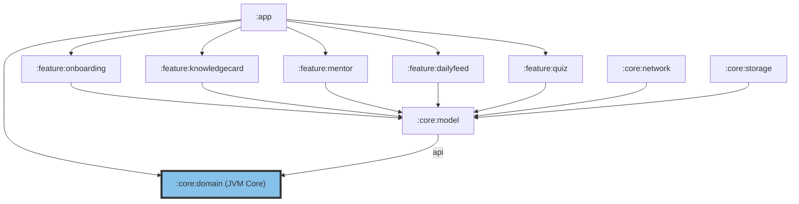

# Dependency Graph - LearnWitMe

Diagram berikut menunjukkan grafik ketergantungan modul di dalam proyek *LearnWitMe*, memperlihatkan modul `:core:domain` sebagai inti dari arsitektur platform.

### Penjelasan:
1.  **`:core:domain`** adalah modul pustaka Kotlin JVM murni tanpa dependensi eksternal, menjadikannya fondasi terdasar dari sistem.
2.  **`:core:model`** mengekspos tipe domain secara transitif menggunakan konfigurasi `api(project(":core:domain"))`.
3.  Modul jaringan (**`:core:network`**), penyimpanan (**`:core:storage`**), dan fitur-fitur (**`:feature:*`**) bergantung pada model dan domain untuk melakukan pertukaran data yang aman dan deterministik.
